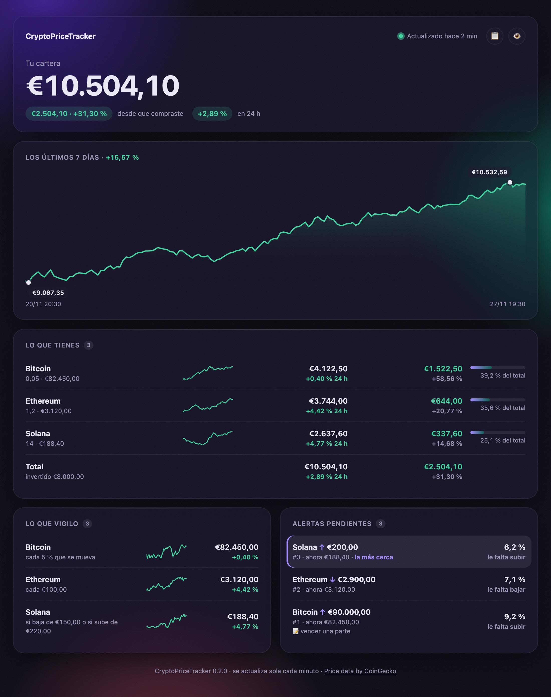

# CryptoPriceTracker

[](https://github.com/SergioCayetano232/CryptoPriceTracker/actions/workflows/tests.yml)

Un bot de Telegram que te avisa cuando una cripto sube o baja de cierto punto.
También lleva tu cartera, y lo manejas todo desde el móvil.

<!-- Cuando exista docs/aviso.jpg, quita el comentario:

-->



## Qué hace

- Te avisa cuando una cripto pasa por un precio, se mueve un % o se sale de un rango.
- Apunta tus compras y ventas, y te dice cuánto vale tu cartera y cuánto ganas.
- Manda gráficas: de tu cartera, del reparto y del histórico de cada cripto.
- Calcula lo que le tocaría a Hacienda de lo que vendes y te saca el CSV para la Renta.
- Tiene un panel web con todo esto, que se puede abrir también desde el móvil.
- Se queda corriendo solo en un servidor (Docker, Windows o Linux).

## Puesta en marcha

Necesitas Python 3.10 o superior y Telegram.

```
python3 -m venv .venv
source .venv/bin/activate        # en Windows: .venv\Scripts\activate
pip install -r requirements.txt
cp .env.example .env             # en Windows: copy .env.example .env
```

1. Crea el bot con **@BotFather** en Telegram (`/newbot`) y copia el token.
2. Pídele tu chat id a **@userinfobot**.
3. Ponlos en el `.env`, junto con las criptos a vigilar: `WATCHLIST=bitcoin:%5`.
4. Escríbele `/start` a tu bot, o no podrá mandarte mensajes.

```
python main.py --test    # te llega un mensaje de prueba
python main.py --loop    # se queda vigilando
```

Lo que admite `WATCHLIST`, la clave gratis de CoinGecko y el resto del `.env`
están en [la configuración](docs/configuracion.md).

## Comandos

Con el bot en marcha, le escribes desde Telegram. Los más útiles:

| Comando | Qué hace |
|---|---|
| `/status` | Cómo van tus criptos ahora |
| `/precio solana` | Lo que vale una cripto y cómo va en 24 h, 7 y 30 días |
| `/alerta bitcoin 70000` | Te avisa una vez cuando llegue a ese precio |
| `/alertas` | Las alertas que tienes puestas y lo que le falta a cada una |
| `/compra bitcoin 0.01 600` | Apunta una compra en la cartera |
| `/cartera` | Cuánto vale tu cartera, cuánto ganas y la gráfica de 7 días |
| `/reparto` | Qué parte de tu cartera es cada cripto |
| `/impuestos` | Lo que le tocaría a Hacienda de lo que has vendido este año |
| `/mute 2h` | Calla los avisos un rato |
| `/ayuda` | Todos los comandos, por temas |

Hay muchos más: [la lista completa](docs/comandos.md). El panel web, el widget
del móvil y cómo abrirlo desde Telegram están en [el panel](docs/panel.md).

## Docker

Con el `.env` ya rellenado:

```
docker compose up -d --build
```

Arranca solo al encender el ordenador y guarda el histórico en un volumen. Para
dejarlo en un servidor Windows o Linux sin Docker, mira
[el despliegue](docs/despliegue.md). Si algo falla, [aquí](docs/problemas.md).

## Para desarrollar

```
pip install -e ".[dev]"
pytest
ruff check . && ruff format --check .
```

En GitHub se pasan solos en cada push. Cómo está organizado el código, en
[desarrollo](docs/desarrollo.md).

## Licencia

MIT. Hecho con Python, SQLite, matplotlib y las APIs de CoinGecko y Telegram.

Price data by [CoinGecko](https://www.coingecko.com).
