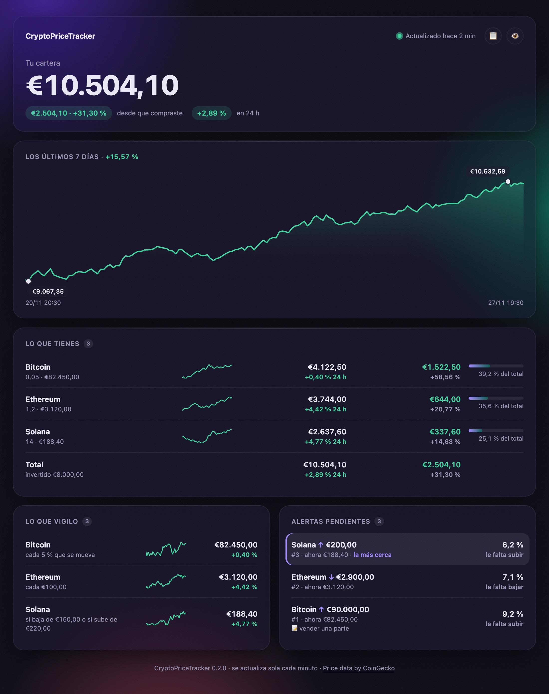

# El panel web

[← Volver al README](../README.md)

**Verlo todo en el navegador:**
```
python main.py --panel
```
Abre <http://127.0.0.1:8000> y verás la cartera, una gráfica de los últimos 7
días, lo que vigilas y las alertas que tienes puestas, ordenadas por lo poco que
les falta. Se actualiza sola cada minuto. Para usar otro puerto:
`--panel 9000`.



*Las cifras son inventadas. Con 👁 o la tecla `O` se tapan las cantidades, y con
📋 copias un resumen para mandarlo por WhatsApp.*

Solo lee lo que el bot ya ha guardado, así que no gasta consultas a CoinGecko y
puede estar abierto a la vez que `--loop`. Si el bot lleva un rato sin guardar
precios, el panel te lo dice arriba. Solo se abre desde el mismo ordenador:
enseña tu cartera y no pide contraseña.

**En el móvil, con un widget:** pon en el `.env` una `PANEL_CLAVE` de al menos
16 caracteres y arranca el panel abierto a tu red de casa:
```
python main.py --panel --red
```
Te dice la dirección (algo como `http://192.168.1.20:8000`). Sin `?clave=` y tu
clave al final, contesta que no. En `/api.json?clave=...` están los datos en
JSON. Para el widget del iPhone, instala [Scriptable](https://scriptable.app),
pega `widgets/scriptable.js`, cambia la `URL` del principio y añade un widget
de Scriptable a la pantalla de inicio. Solo llega con el móvil en la misma wifi.

**Como una app:** abre el panel en el móvil (con su `?clave=`) y, en Safari,
Compartir → «Añadir a pantalla de inicio»; en Chrome, menú → «Añadir a
pantalla de inicio». Queda con su icono y se abre a pantalla completa, sin la
barra del navegador.

**Dentro de Telegram:** `/panel` manda un botón que abre el panel sin salir del
chat. Telegram solo abre direcciones `https` públicas, así que hay que sacar el
panel a internet, por ejemplo con un túnel de Cloudflare:
```
python main.py --panel
cloudflared tunnel --url http://127.0.0.1:8000
```
Pon la dirección que te dé en el `.env` como `PANEL_URL` y reinicia el bot y el
panel. Telegram firma quién abre el botón con el token del bot: si no es la
cuenta de `TELEGRAM_CHAT_ID`, no entra. Con `PANEL_URL` puesta, `/` y
`/api.json` piden `?clave=` aunque lleguen por el túnel.

Con eso puesto, `/enlace` te da una dirección para enseñar tu cartera: cómo te
va en %, el reparto y la gráfica de la semana sin cifras. Va firmada con el
token del bot y deja de valer a las 24 h; si cambias el token, caducan todas.
